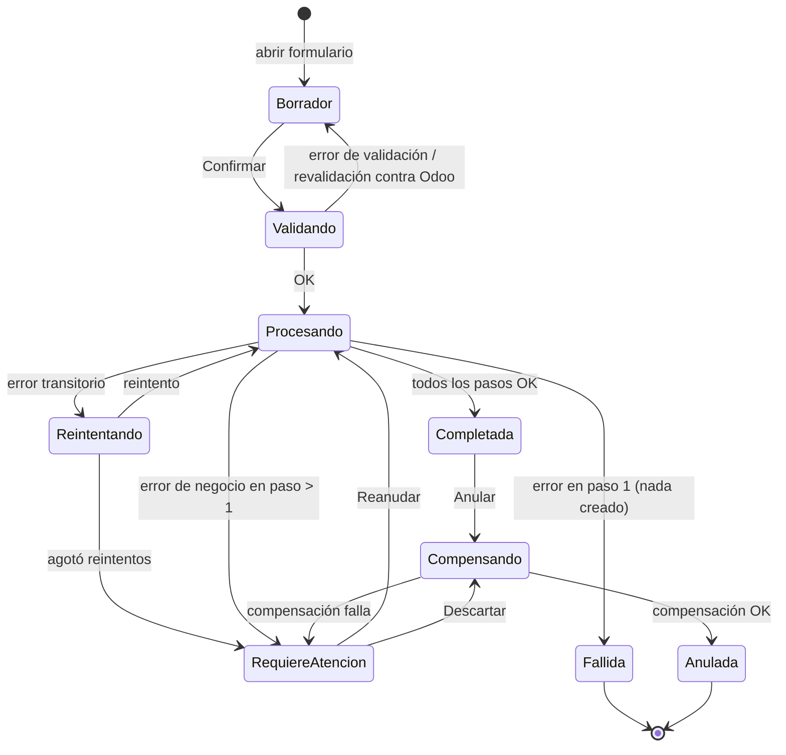
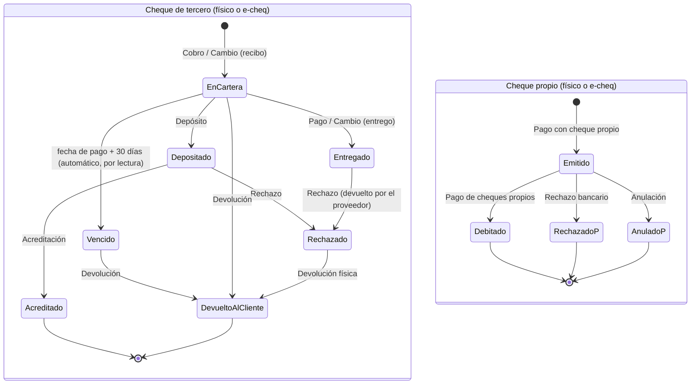
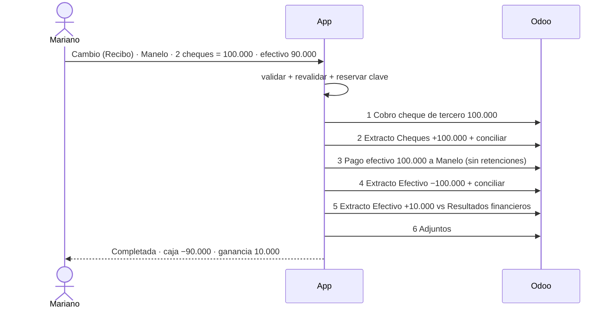

# Especificación — Módulo de Tesorería sobre Odoo (v2)

> **Fuentes consolidadas**
> - R1 — 22/10/2026 11:44 · Pagos a proveedores, cobros, conciliación, cheques de terceros y propios
> - R2 — 22/10/2026 12:04 · Gastos e ingresos, multi-cuenta, factura fiscal
> - R3 — 24/10/2026 11:17 · Movimientos entre diarios, retiros/depósitos de socios
> - R4 — 24/10/2026 11:34 · Cambio de cheques (directo e inverso), pago de cheques propios
> - **XL** — Planilla `mvp_app_contable` (hojas: Movimientos – Vista General, Vista Extracto, Vista Resumen PN, Operaciones, Cuentas gastos e ingresos)
> - **RC** — Respuestas del cliente posteriores a las reuniones (registro de decisiones §5.1)
>
> **Convenciones**
> - **[DECIDIDO]** surge explícito de una fuente (se indica cuál).
> - **[RECOMENDADO]** propuesta que cierra un hueco; se implementa salvo que §5.2 se resuelva distinto.
> - **[ABIERTO Pn]** requiere respuesta antes de implementar la parte afectada.
> - Montos de ejemplo en ARS. "Diario" = journal de Odoo (banco, caja, billetera, cheques).
> - Ante contradicción entre fuentes, prevalece: RC > XL > R4 > R3 > R2 > R1, y la contradicción se lista en §4.

---

## 1. Objetivo

Reemplazar las planillas de Excel con las que el tesorero (Mariano) registra día a día los movimientos de fondos, por un módulo nuevo dentro de la app existente (en producción) que:

1. Presente **operaciones de negocio unificadas** en pantallas simples, pensadas para alguien que no es contador.
2. Traduzca cada operación, en segundo plano, a la **secuencia exacta de registros en Odoo** (facturas, pagos, retenciones, líneas de extracto, conciliaciones, asientos de resultado), dejando todo conciliado cuando corresponde.
3. Cubra el **ciclo de vida completo de los cheques** (de terceros y propios, físicos y electrónicos), incluyendo depósito, rechazo y vencimiento.
4. Reproduzca las tres vistas del Excel actual: **Vista General** (matriz conceptos × diarios), **Vista Extracto** (por diario, con conciliación) y **Resumen PN** (saldos de inicio y fin por diario).
5. Exponga los pendientes de conciliación para revisión (Jan / contador).

Odoo es la única fuente de verdad contable. La app no persiste como verdad saldos, estados de cheques, estados de pago ni de conciliación: los lee de Odoo. La app sí persiste el **registro de orquestación** de cada operación (qué pidió el usuario, qué registros creó en Odoo, en qué paso está) y la configuración propia del módulo.

## 2. Alcance

### 2.1 Dentro de alcance
**Operaciones (§10)** — en el orden del menú definido en XL:
1. Pago a proveedor (multi-método, imputación a facturas, retenciones practicadas, carga de factura nueva)
2. Cobro de cliente (multi-método, imputación a facturas, retenciones sufridas)
3. Gasto (multi-cuenta, factura fiscal opcional)
4. Ingreso (multi-cuenta)
5. Movimiento entre diarios
5b. Compra / Venta de divisas (ARS ↔ USD)
6. Retiro / Depósito de socios
7. Pago de cheques propios (débito bancario)
8. Cambio de cheque — recibo cheques
9. Cambio de cheque — entrego cheques
10. Depósito de cheques de terceros (+ acreditación)
11. Cheque de tercero rechazado / devuelto / vencido
12. Cheque propio rechazado / anulado

**Subflujos (§10.S)**: selector de cartera, alta de cheque de tercero, emisión de cheque propio, imputación a facturas, retenciones practicadas, retenciones sufridas, factura de compra, líneas de imputación multi-cuenta.

**Vistas (§11)**: Inicio, Vista General, Vista Extracto, Resumen PN, Cartera de cheques de terceros, Cheques propios emitidos, Pendientes de conciliación, Historial, Detalle de operación, Configuración.

**Transversal**: adjuntos, rol Tesorero, auditoría, anulación, orquestación tolerante a fallas, cierre diario de extractos.

### 2.2 Fuera de alcance
| Ítem | Motivo |
|---|---|
| Importación automática de extractos bancarios | RC: Mariano los carga a mano. La matriz §9.7 queda configurable para soportarla a futuro sin rediseño |
| Aprobación por monto (segundo usuario) | No fue pedido por ninguna fuente |
| Revaluación de saldos en USD (diferencia de cambio no realizada) | Tarea contable de cierre de mes, no de tesorería diaria [ABIERTO P26] |
| Cheques en USD | No surgen de ninguna fuente [ABIERTO P27] |
| Constatación de comprobantes en AFIP/ARCA (CAE) | No pedido; candidato a mejora |
| Emisión de facturas de venta | El módulo es de tesorería; las facturas de venta se cargan por el circuito existente |

---

## 3. Glosario

| Término de la app (Mariano) | Concepto en Odoo | Nota |
|---|---|---|
| Operación | No existe. Entidad propia de la app que agrupa N registros de Odoo | Unidad de trabajo del usuario |
| Pago | Pago saliente ("enviar") a proveedor | |
| Cobro | Pago entrante ("recibir") de cliente | Odoo dice "pago"; la UI dice "Cobro" [R1] |
| Método de pago / diario | Diario de liquidez o de cheques + método de pago | Inventario en §6.2 |
| Tablero | Dashboard de contabilidad, un panel por diario | Término de Máximo |
| Extracto / movimiento | Línea de extracto del diario | Lo que se ve en "Vista Extracto" |
| Conciliado ✓ / ✗ | Línea de extracto conciliada / no conciliada | [XL, R1] |
| En proceso | Pago confirmado, sin conciliar | |
| Pagado | Pago confirmado y conciliado | |
| Establecer cuenta | Contrapartida de una línea de extracto sin pago (gasto/ingreso) | En Odoo se hace después de confirmar la línea [XL *5] |
| Cuenta puente | "Movimientos entre bancos" (transferencias de liquidez) | Debe quedar en 0 [R3] |
| Cartera | Cheques de terceros en nuestro poder, disponibles | |
| Cheque propio | Cheque emitido contra una cuenta bancaria propia | |
| E-cheq | Cheque electrónico | Mismo ciclo de vida, sin papel |
| Resultados financieros | Cuenta de ingresos/egresos financieros | Diferencia en cambio de cheques [R4] |
| Retención practicada | Retención que la empresa aplica al pagar (es agente) | RC: Mariano retiene |
| Retención sufrida | Retención que un cliente nos aplica al pagarnos | [ABIERTO P4] |
| Factura de compra | Comprobante de proveedor (A, B, C, M, E, tickets) | |
| Imputar | Conciliar un pago/cobro con facturas o notas de crédito abiertas | |
| Pago a cuenta / anticipo | Pago sin imputar, que queda como saldo a favor del contacto | |
| Resumen PN | Vista de saldos de inicio y fin por diario | Significado de "PN" en [ABIERTO P9] |

Los nombres técnicos exactos (modelos, campos, estados, versión de Odoo, módulos de localización) se confirman en Fase 0. Este documento describe comportamiento, no implementación.

---

## 4. Análisis crítico

Ordenado por impacto. Cada punto cierra con la decisión que adopta esta spec.

### 4.1 Multimoneda: USD y Vale USD tienen movimientos — impacto transversal
Hay dos diarios en USD con movimientos (D21). En Odoo la moneda de la empresa es ARS: cada movimiento en USD se guarda en dólares **y** en su equivalente en pesos, al tipo de cambio que Odoo tenga cargado para esa fecha. Esto genera cuatro riesgos concretos:
1. **Totales que mezclan monedas.** El "Total" del Resumen PN y la fila TOTAL de la Vista General sumarían pesos con dólares y darían un número sin sentido.
2. **Tipo de cambio faltante o desactualizado en Odoo.** Si no hay cotización para la fecha, Odoo usa la última disponible y el equivalente en pesos queda mal sin que nadie lo note.
3. **Pasar pesos a dólares no es un Movimiento entre diarios.** Se entregan X pesos y se reciben Y dólares, con un tipo de cambio que es el de la transacción real (oficial, MEP o informal), no el de Odoo. Tratarlo como movimiento rompe la cuenta puente.
4. **Movimiento USD → USD con fechas distintas.** Origen y destino se valúan en pesos a cotizaciones de días distintos: el puente queda en 0 en dólares pero ≠ 0 en pesos.
**Decisión:** monedas siempre separadas en vistas y totales; nueva operación Compra/Venta de divisas (§10.5b); reglas de tipo de cambio en §9.12; movimientos entre diarios solo dentro de la misma moneda y valuados a una única cotización.

### 4.2 La orquestación no es atómica — riesgo técnico #1
Una operación genera entre 2 y 10 escrituras en Odoo. Un Gasto con factura y retenciones, por ejemplo, implica factura, publicación, pago, retención, extracto y conciliación. Odoo no ofrece transacción entre llamadas. Si una falla a la mitad, quedan registros huérfanos: facturas pagadas a medias, cajas descuadradas, contactos con saldos falsos.
**Decisión:** cada operación es un proceso por pasos persistido (saga), con pasos idempotentes, verificación del resultado cuando la respuesta es ambigua, reintento y compensación (§13). Nada se muestra como "Completada" hasta confirmar todos los pasos en Odoo.

### 4.3 Retenciones + multi-método: Odoo nativo calcula mal si se hace "un pago por método"
En Odoo estándar, un pago = un diario = un método. Si un Pago a proveedor con Bica + Efectivo + Cheque se registra como tres pagos separados y la empresa es agente de retención, el motor calcula la retención **tres veces sobre bases parciales**. Cada base puede quedar bajo el mínimo no sujeto a retención: la retención no se practica cuando correspondía, o se practica mal. El error es fiscal y lo cobra ARCA.
**Decisión:** la retención se calcula **una sola vez sobre el total de la operación**. La Fase 0 debe identificar qué mecanismo de la instalación lo permite. La localización argentina de ADHOC tiene "grupos de pago" (un pago con N métodos y retenciones) y Odoo Enterprise 17+ tiene su módulo de retenciones. La spec no avanza sobre la implementación de retenciones hasta tener ese hallazgo (§6.2).

### 4.4 Retenciones disparadas por pagos "técnicos"
Cambio de cheques, Pago de cheques propios y las compensaciones internas generan pagos y cobros contra contactos que **no** son pagos de bienes o servicios. Si el contacto tiene un régimen de retención configurado (Manelo podría ser también proveedor), el motor puede retenerle sobre el pago en efectivo del cambio de cheques.
**Decisión:** los pagos técnicos se crean con retenciones explícitamente desactivadas. Hay un test de aceptación específico para esto (§16).

### 4.5 Dos caminos para el mismo resultado: "Gasto con factura" vs "Pago a proveedor con factura nueva"
XL ubica la factura fiscal en Gastos (*6). Si además el Pago permite cargar una factura nueva, existen dos pantallas que generan exactamente los mismos registros en Odoo: factura de compra, pago imputado y extracto conciliado. No está mal (responden a dos modelos mentales: "gasté en pintura" vs "le pago a Todo Color"), pero si se implementan como dos motores distintos van a divergir.
**Decisión:** un único subflujo "Factura de compra" (§10.S7), reutilizado por ambas pantallas. La diferencia es solo de entrada: Gasto parte de la cuenta y el importe; Pago parte del proveedor y su deuda.

### 4.6 Gasto con factura sin retención
Un Gasto **sin** factura a un proveedor sujeto a retención no pasa por el motor de retenciones (es una línea de extracto contra una cuenta, no un pago). Para un proveedor habitual es un agujero fiscal.
**Decisión:** en Gasto, si el contacto elegido tiene régimen de retención activo, la app advierte "Este proveedor está sujeto a retención: registralo como Pago a proveedor o marcá 'lleva factura'". Si se confirma igual, queda registrado en auditoría. Si debe bloquearse en lugar de advertir: P3.

### 4.7 Cuentas personales registradas como diarios de la empresa
XL lista como diarios de liquidez **Cuenta Vale, Maxi Mp, Vale Mp, Andre Bica, Mili Bica, Vale USD**. Si son cuentas personales de socios o familiares tratadas como fondos de la empresa, falta una regla para distinguir un movimiento entre diarios (la plata sigue siendo de la empresa) de un retiro de socio (la plata deja de serlo). Sin esa regla, el Resumen PN mezcla patrimonio personal con el de la empresa y el resultado del retiro de socios queda subestimado.
**Decisión:** se tratan como diarios de la empresa y la regla es: **trasladar fondos entre cualquier par de diarios = Movimiento entre diarios; consumo personal de un socio desde cualquier diario = Retiro de socio**. P2 confirma el modelo.

### 4.8 Depender del auto-match de Odoo para conciliar es frágil
R1 describe que Odoo detecta la coincidencia por fecha, etiqueta, contacto e importe. Con dos movimientos iguales el mismo día y al mismo contacto (frecuente: dos cheques de 50.000 de Manelo), el emparejamiento es ambiguo.
**Decisión:** la app concilia **explícitamente**, vinculando la línea de extracto con la línea pendiente del registro que ella misma creó, por identificador. El auto-match queda como respaldo para cargas hechas fuera de la app.

### 4.9 Montos con signo tipeados por el usuario
R1, R2, R4 y XL describen tipear importes en negativo. XL *4 deja la decisión abierta ("pensá en lo más simple para Mariano"). Un signo olvidado invierte el asiento.
**Decisión [DECIDIDO, XL *4 delega]:** el usuario **siempre ingresa importes positivos** y el tipo de operación define el sentido. La UI muestra el efecto con color y flecha antes de confirmar.

### 4.10 El ciclo del cheque estaba incompleto en las fuentes
Ninguna reunión cubrió el depósito de un cheque de tercero, su rechazo, su vencimiento ni el rechazo de un cheque propio. Sin esas operaciones, la cartera de la app se desincroniza de la realidad en días y Mariano vuelve a Odoo.
**Decisión:** se incorporan como operaciones 10, 11 y 12, con estados completos en §8.3.

### 4.11 Observación opcional vs. etiqueta obligatoria en el extracto
XL marca la observación como opcional en Pago, Cobro, Movimiento, Socios y Pago de cheques propios. Toda línea de extracto en Odoo necesita etiqueta, y la Vista Extracto la muestra como columna principal.
**Decisión:** se respeta la opcionalidad. Si el usuario no escribe nada, la app genera la etiqueta automáticamente según la plantilla de §9.3, para que ninguna línea quede sin descripción legible.

### 4.12 Cajas locales ausentes en las vistas
R3 menciona las cajas de efectivo Kiver, Ruta, Centro y Estribo. Las vistas de XL no las incluyen. Puede ser intencional (las maneja otro circuito), pero si se registran movimientos entre esas cajas y Administración y no se muestran, la Vista General no cuadra con la realidad.
**Decisión:** se incluyen como columnas opcionales, ocultas por defecto. P11 confirma.

### 4.13 Valor real del módulo
El valor no está en reemplazar formularios de Odoo (ya existen), sino en tres cosas: (1) colapsar secuencias de 3 a 10 pasos en una pantalla, (2) eliminar errores de signo, cuenta, conciliación y retención, y (3) dar las vistas diarias del Excel con datos reales de Odoo. Toda decisión de UX se mide contra esos tres puntos.

---

## 5. Decisiones y preguntas

### 5.1 Registro de decisiones tomadas
| # | Decisión | Fuente |
|---|---|---|
| D1 | Los extractos bancarios los carga Mariano a mano. La app crea la línea de extracto y concilia también en transferencias bancarias | RC |
| D2 | En Odoo todo se registra con el usuario del token de integración. En la app se agrega el rol **Tesorero** al módulo de usuarios existente | RC |
| D3 | Un extracto de Odoo por día y por diario, con saldo inicial, saldo final y cierre | RC |
| D4 | El efectivo de cajas locales hacia Administración se registra como Movimiento entre diarios | RC |
| D5 | Se cargan facturas de proveedores y de clientes en Odoo: pagos y cobros se imputan a facturas | RC |
| D6 | La empresa practica retenciones al pagar | RC |
| D7 | Importes siempre positivos; el sentido lo da la operación | XL *4 |
| D8 | Multi-método en pagos y cobros | R1, XL *1 |
| D9 | Multi-cuenta en Gastos e Ingresos | XL (Operaciones) |
| D10 | Factura fiscal opcional en Gastos (casilla "¿Lleva factura fiscal?") | XL *6 (R2 la había dejado en standby; XL la incluye) |
| D11 | Retiros/Depósitos de socios: **una cuenta contable por socio**, el mismo asiento en sentido inverso para el depósito | XL ("Seleccionar la cuenta del socio"), R3 |
| D12 | Retiros/Depósitos se mantienen como operación separada de Gastos/Ingresos | XL *7 pide opinión: se recomienda separar (lista de cuentas distinta y mínima, semántica propia para reportes, costo nulo) |
| D13 | Cambio de cheques inverso: se recibe efectivo **por el valor total del cheque** y se registra un gasto por la diferencia (modelo simétrico) | XL (Operaciones), confirma §4 de v1 |
| D14 | Ganancia / interés del cambio de cheques: siempre calculado | R4, XL |
| D15 | Adjuntos: obligatorios en Cambio de cheque (recibo); opcionales en el resto, incluido Cambio (entrego) | XL |
| D16 | Observación: obligatoria en Gasto, Ingreso y ambos Cambios de cheque; opcional en el resto con etiqueta autogenerada (§9.3) | XL |
| D17 | La cuenta de gastos/ingresos se elige por categorías: Gastos, Ingresos, Retiros socios, Activo, Cupones por cobrar | XL (hoja Cuentas) |
| D18 | Fecha contable: por defecto el día actual | R1, XL |
| D19 | Vistas: General (matriz), Extracto, Resumen PN, cada una con granularidad día/mes/año | XL |
| D20 | Selección de usuarios ("usar usuarios") para registrar quién encargó | R1, XL |
| D21 | Existen diarios en USD (**USD**, **Vale USD**) con movimientos: el módulo contempla multimoneda ARS/USD | RC (corrige respuesta anterior), XL |

### 5.2 Preguntas abiertas
Cada pregunta trae el default que se implementa si no hay respuesta.

**Bloqueantes**
| # | Pregunta | Default | Afecta |
|---|---|---|---|
| P1 | ✅ RESUELTA (D21): hay USD con movimientos | — | — |
| P24 | ¿Quién carga hoy las cotizaciones USD en Odoo y de qué fuente (BNA oficial, automática por módulo, manual)? ¿Todos los días? | Automática por módulo de Odoo; si falta la del día, la app bloquea operaciones en USD (§9.12) | Toda operación en USD |
| P25 | Compra/Venta de divisas: ¿qué tipo de cambio se usa para valuar en pesos el lado USD: el de la transacción real o el de Odoo del día? | El de la transacción real (implícito) | §10.5b |
| P26 | ¿La revaluación mensual de saldos USD la hace el contador en Odoo, o tiene que estar en el módulo? | La hace el contador; fuera del módulo | Resumen PN |
| P28 | ¿Se paga o cobra en USD a proveedores/clientes (con facturas en ARS o en USD)? ¿Hay gastos, ingresos o retiros de socios en USD? | Sí a todo; ver §9.12 | Pago, Cobro, Gasto, Ingreso, Socios |
| P29 | Total en pesos del Resumen PN: ¿se muestra un equivalente ARS de los saldos USD? ¿A qué cotización (oficial, MEP, la de Odoo)? | Total por moneda + equivalente ARS opcional a la cotización de Odoo del día, rotulado como "referencial" | Resumen PN |
| P2 | Cuenta Vale, Maxi Mp, Vale Mp, Andre Bica, Mili Bica: ¿son diarios de la empresa operados por socios? ¿Confirman la regla de §4.7? | Sí a ambas | Movimiento, Socios, Resumen PN |
| P3 | Retenciones: ¿qué regímenes aplican (Ganancias, IIBB y en qué jurisdicciones, SUSS, IVA)? ¿Odoo ya las calcula hoy y con qué módulo? ¿Mariano ingresa el importe **a cancelar** (bruto) o el **neto a entregar**? ¿El Gasto a un proveedor sujeto a retención se advierte o se bloquea? | Se ingresa el bruto a cancelar; se advierte | Pago, Gasto con factura |
| P4 | ¿Los clientes les practican retenciones al cobrar (entregan certificados)? | Sí, se habilita la línea "Retención sufrida" en Cobro | Cobro |
| P5 | ¿Quién carga hoy las facturas de compra en Odoo? ¿Mariano también? | Lo hace otra persona; Mariano también puede cargarlas desde Pago y Gasto | Pago |
| P6 | Gasto con factura: ¿se puede pagar parcialmente en el acto? | No: se paga el total. Para pagos parciales se usa Pago a proveedor | Gasto |
| P7 | Cheque rechazado: ¿se emite nota de débito al cliente? ¿Los gastos bancarios del rechazo se le trasladan? Si el cheque vino de un Cambio de cheques, ¿se revierte la ganancia ya registrada? | ND por el importe del cheque; gastos opcionales trasladables con una casilla; la ganancia no se revierte | Op. 11 |
| P8 | Vista General en mes/año: ¿cada fila es una operación o se agrupa por concepto? | Día: una fila por operación. Mes/año: una fila por cuenta contrapartida | Vista General |
| P9 | ¿Qué significa "PN" en Resumen PN? ¿El saldo de cheques propios emitidos no debitados resta del total? | "Posición neta"; sí, resta | Resumen PN |
| P10 | "Cupones por cobrar": ¿en qué operación se usa? (¿acreditaciones de tarjeta?) | Cuenta seleccionable en Ingreso y como destino en Movimiento | Ingreso |
| P11 | ¿Las cajas locales (Kiver, Ruta, Centro, Estribo) se muestran en las vistas? | Columnas opcionales, ocultas por defecto | Vistas |
| P12 | Depósito de cheques: ¿la acreditación se registra en el mismo acto o cuando aparece en el banco? | Dos pasos, con una casilla "Acreditado en el acto" | Op. 10 |
| P13 | Medición del plan de cuentas (§6.2.1): criterio para decidir entre plan filtrado o lista blanca | Lista blanca por categoría (D17), precargada con las cuentas usadas | Gasto, Ingreso, Socios |

**No bloqueantes**
| # | Pregunta | Default |
|---|---|---|
| P14 | Fecha contable: ¿hoy siempre, o recordar la última elegida? (R1 lo dejó en evaluación por la carga a día vencido) | Hoy al abrir; durante la sesión se recuerda la última; banner si ≠ hoy |
| P15 | "Encargado por": ¿obligatorio? ¿Usuarios de la app o de Odoo? | Opcional; usuarios activos de la app |
| P16 | Roles Revisor (Jan) y Supervisor (Máximo): ¿se reutilizan roles existentes? | Se mapean en Fase 0 |
| P17 | ¿Operan con e-cheqs? | Sí; el modelo los soporta (§10.S2) |
| P18 | ¿Se pueden dar de alta contactos desde la app? | Sí, alta rápida con CUIT validado |
| P19 | Pago de cheques propios: ¿se registran en la misma operación los impuestos y comisiones que el banco debita junto al cheque? | Campo opcional "gastos bancarios" que genera líneas vinculadas |
| P20 | Anulación: ¿quién puede anular y hasta cuándo? | Tesorero mientras el día no esté cerrado; después, solo Supervisor |
| P21 | ¿"Recibos pendientes" sigue en uso como cuenta de Ingreso? | Se excluye de la lista blanca |
| P22 | Diferencia del cambio de cheques: ¿siempre calculada o editable por Supervisor? | Calculada; editable solo por Supervisor |
| P23 | Factura de compra: ¿el adjunto del comprobante es obligatorio? | Obligatorio |
| P27 | ¿Reciben o emiten cheques en USD? | No; el alta de cheques es solo en ARS |
| P30 | Compra/Venta de divisas: umbral de desvío del tipo de cambio implícito respecto de la cotización de Odoo para advertir posible error de tipeo | 15% |

---

## 6. Fase 0 — Reconocimiento obligatorio

Producir un informe con hallazgos y discrepancias contra esta spec. No escribir código de la feature hasta cerrarla.

### 6.1 App existente
- Autenticación, modelo de usuarios y roles; cómo agregar el rol Tesorero sin renombrar identificadores existentes ni romper comparaciones numéricas de nivel de rol.
- Capa de servicio actual hacia Odoo: protocolo, sesión/token, reintentos, logging, si hoy solo lee o también escribe.
- Patrones existentes: navegación entre sub-aplicaciones, formularios, carga de adjuntos, toasts/errores, tablas, filtros, exportación.
- Infraestructura de jobs en segundo plano o colas (requerida por §13). Si no existe, proponer la mínima viable.
- Esquema de base de datos de la app y convenciones de migraciones.

### 6.2 Odoo
- Versión y edición exactas. Módulos de localización argentina instalados (Odoo Enterprise `l10n_ar*` o la localización de ADHOC). **Hallazgo crítico:** ¿existe un mecanismo de pago con múltiples métodos y retenciones calculadas sobre el total (grupo de pagos o equivalente)? Ver §4.3.
- Retenciones: módulo, regímenes configurados, cómo calcula (acumulado mensual, mínimos, padrones), cómo emite certificados, cómo se anulan.
- Cheques: módulo; cómo modela alta de cheque de tercero (número, banco, CUIT del librador, fecha de pago, importe), e-cheqs, cartera, entrega, depósito, rechazo, devolución, cheques propios (chequeras, numeración, fecha de pago), y los estados posibles de cada uno.
- Estados reales de pagos y transiciones disponibles por API.
- Facturas: tipos de documento habilitados, numeración (punto de venta + número), impuestos de compra (alícuotas de IVA, percepciones), condición frente al IVA de la empresa y de los contactos.
- Diarios: tipo, moneda, cuentas de pagos y recibos pendientes, métodos de pago. Inventario esperado (XL + R3):

| Grupo | Diarios |
|---|---|
| Efectivo | Efectivo Administración; cajas locales Kiver, Ruta, Centro, Estribo |
| Bancos | Bica, ICBC |
| Billeteras | Mercado Pago, Maxi Mp, Vale Mp |
| Cuentas de socios/familia | Cuenta Vale, Andre Bica, Mili Bica |
| Moneda extranjera | USD, Vale USD (D21) |
| Cheques | Cheques de terceros; diarios o métodos de cheques propios por banco |

- Multimoneda: moneda de la empresa; moneda de cada diario USD y su cuenta; origen y frecuencia de las cotizaciones (`P24`); días sin cotización en los últimos 12 meses; cuenta de diferencias de cambio; si existe revaluación configurada; cómo se registra hoy una compra/venta de dólares (para reproducirla en el oráculo §6.3).
- Cuentas: Movimientos entre bancos (puente), Resultados financieros (¿una o dos, ingreso y egreso?), una cuenta por socio para retiros, Gastos generales, Retenciones y percepciones varias, Retenciones sufridas (por impuesto), Cobro de intereses extra, Descuentos obtenidos, Inversiones en locales, Cupones por cobrar, Cheques rechazados, Diferencias de caja.
- Modelos de conciliación automática activos que puedan interferir con la conciliación explícita (§4.8).
- Fecha de bloqueo contable.
- Cómo adjuntar archivos a facturas, pagos, líneas de extracto y asientos.
- Cómo se crean, encadenan y cierran los extractos diarios; extractos históricos sin cerrar o con saldos encadenados rotos.
- Cómo asignar varias contrapartidas a una sola línea de extracto por API (gasto multi-cuenta; XL: "confirmar una primero y luego la otra").
- Permisos del usuario del token para todas las escrituras listadas.

#### 6.2.1 Medición del plan de cuentas (resuelve P13)
Entregar, leído de Odoo: total de cuentas activas y archivadas; distribución por tipo; jerarquía (agrupadoras vs. imputables); cuentas usadas en los últimos 12 meses en diarios de liquidez, con su frecuencia; nombres duplicados o ambiguos.
Criterio propuesto: si por categoría hay ≤ 30 cuentas imputables y sin ambigüedad → plan filtrado por tipo. Si no → lista blanca administrable por categoría, precargada con las cuentas usadas en los últimos 12 meses.

### 6.3 Oráculo de asientos
Reproducir manualmente en una base de prueba de Odoo cada operación de §10 con los ejemplos de las fuentes, más un caso con retención y uno de rechazo, y registrar los asientos resultantes. Esos asientos son la referencia de los tests de aceptación (§16).

---

## 7. Actores y permisos

| Rol | Quién | Puede |
|---|---|---|
| Tesorero (nuevo) | Mariano | Todas las operaciones; vistas; cerrar día; anular dentro de la ventana (P20) |
| Revisor | Jan / contador | Solo lectura de todo; marcar operaciones como "Revisada" con comentario |
| Supervisor | Máximo | Todo lo anterior + anular fuera de ventana, reabrir días cerrados, editar la diferencia del cambio de cheques, administrar la configuración (§11.10) |

- El mapeo de Revisor y Supervisor a roles existentes se resuelve en Fase 0 (P16).
- En Odoo no hay distinción de usuarios: todo se escribe con el usuario del token (D2).
- Quien no tenga un rol del módulo no lo ve en la navegación y recibe 403 si accede por URL.

---

## 8. Modelo conceptual

### 8.1 Operación (persistida en la app)
- Identificador y **clave de idempotencia** generada al abrir el formulario.
- Tipo, fecha contable, cabecera (contacto, observación, encargado por, registrado por, adjuntos).
- Detalle según tipo: líneas de método, cheques, facturas imputadas, retenciones, líneas de imputación de cuentas, diarios origen/destino.
- Pasos de orquestación: lista ordenada, cada paso con estado, payload, identificador del registro creado en Odoo, error, intentos y timestamps.
- Estado de orquestación (§8.2) y estado contable derivado (leído de Odoo): conciliado / parcial / pendiente.
- Vínculos: operación compensatoria (si fue anulada), operación de origen (ej. el rechazo apunta al cobro que recibió el cheque).

### 8.2 Estados de orquestación

- **Borrador**: solo en la app; se recupera si se cierra la pantalla; se descarta a los 7 días.
- **Completada con pendiente esperado** (ej. cheque propio en proceso, depósito sin acreditar): no es error. Se muestra "Completada · pendiente de débito/acreditación".
- **RequiereAtencion**: bloquea otras operaciones sobre los mismos cheques o facturas y aparece destacada en Inicio.

### 8.3 Ciclo de vida de cheques

- "Vencido" es un estado de lectura: la app lo deriva de la fecha (no escribe nada en Odoo) y solo habilita Devolución o Rechazo con motivo "vencido".
- Las transiciones que no figuran en el diagrama están prohibidas, y la UI no ofrece la acción.

---

## 9. Reglas transversales

### 9.1 Fecha contable
- Default según P14. Selector en la cabecera de todas las operaciones.
- Prohibidas las fechas futuras.
- Fecha ≤ fecha de bloqueo de Odoo → bloqueo con mensaje ("Período cerrado hasta dd/mm/aaaa").
- Fecha en un día con extracto cerrado para el diario involucrado → bloqueo, salvo Supervisor.
- Fecha de más de 7 días atrás → confirmación adicional.
- Una operación usa una sola fecha contable para todos sus registros. Excepción: la acreditación de un depósito y la fecha de acreditación en un movimiento entre diarios (§10.5).
- "Hoy" se calcula en hora de Argentina (UTC−3), sin importar el dispositivo.
- Fechas distintas de la contable y que no la reemplazan: fecha de pago del cheque, fecha del comprobante, fecha del certificado de retención.

### 9.2 Importes
- Siempre positivos (D7); la operación define el sentido.
- Formato es-AR (miles con punto, decimales con coma), 2 decimales, fuente tabular.
- Se rechazan: 0, negativos, más de 2 decimales, no numéricos y valores por encima de un tope configurable.
- Los totales se muestran en vivo y se recalculan en el servidor antes de enviar. Ante discrepancia prevalece el servidor y se avisa.
- Redondeo: en imputaciones y retenciones, la diferencia de redondeo (≤ 0,01 por línea) se ajusta en la última línea, nunca en una línea nueva.

### 9.3 Observación y etiqueta
- Obligatoriedad según D16. Entre 3 y 200 caracteres cuando se escribe.
- Etiqueta autogenerada cuando se deja vacía:

| Operación | Plantilla |
|---|---|
| Pago | `Pago {proveedor}` + ` — Fc {números}` si imputa facturas |
| Cobro | `Cobro {cliente}` + ` — Fc {números}` |
| Movimiento | `Mov. {origen} → {destino}` |
| Socios | `{Retiro|Depósito} {socio}` |
| Pago cheques propios | `Débito cheque {número} — {proveedor}` |
| Depósito / acreditación | `Depósito cheque {número} — {banco}` |
| Rechazo | `Rechazo cheque {número} — {motivo}` |

- En operaciones compuestas, cada registro lleva la observación más un sufijo de contexto (ej. "Cambio de cheque — Manelo — diferencia").

### 9.4 Contacto
- Selector con búsqueda por nombre y CUIT sobre contactos activos de Odoo. Se muestra el saldo de cuenta corriente al lado.
- Obligatorio en: Pago, Cobro, ambos Cambios, Gasto/Ingreso con factura. Opcional en: Gasto, Ingreso. No aplica en: Movimiento, Socios (la cuenta identifica al socio), débito de cheques propios, línea de diferencia del cambio, depósito.
- Alta rápida (P18): nombre, CUIT (dígito verificador validado), condición frente al IVA, tipo cliente/proveedor. Si el CUIT ya existe, se ofrece usar ese contacto.
- Un contacto puede ser cliente y proveedor a la vez.
- Contacto archivado entre el borrador y la confirmación → vuelve a Borrador.

### 9.5 Diarios
- Se leen de Odoo: diarios de liquidez y de cheques activos, en ARS y USD (D21). Cada diario muestra su moneda junto al nombre cuando es USD.
- Orden fijo, el mismo de XL: Efectivo Admin., Bica, ICBC, Mercado Pago, USD, Cheques de Terceros, Cuenta Vale, Maxi Mp, Vale Mp, Andre Bica, Mili Bica, Vale USD. Luego las cajas locales (P11).
- Los diarios USD no se ofrecen en: Cambio de cheques, Pago de cheques propios, Depósito/Acreditación, ni como método de cheque (P27).
- Disponibilidad por operación:

| Operación | Diarios permitidos |
|---|---|
| Pago / Cobro | Efectivo Admin., bancos, billeteras, cuentas de socios; métodos de cheque según §10.1/10.2 |
| Gasto / Ingreso | Efectivo Admin., bancos, billeteras, cuentas de socios |
| Movimiento entre diarios | Todos los de liquidez, incluidas las cajas locales (D4). No el de cheques (para eso está Depósito) |
| Socios | Todos los de liquidez salvo cajas locales |
| Cambio de cheques | Efectivo: Efectivo Admin. por defecto, editable a otros diarios de efectivo o billetera |
| Pago cheques propios / Acreditación | Solo bancos |

### 9.6 Cuentas contables
- Categorías (D17): **Gastos**, **Ingresos**, **Retiros socios**, **Activo**, **Cupones por cobrar**. Gasto ofrece Gastos + Activo. Ingreso ofrece Ingresos + Activo + Cupones por cobrar (P10). Socios ofrece Retiros socios.
- Fuente según P13. Se muestran con código y nombre, con búsqueda.
- Cuentas fijas del sistema, no seleccionables por el usuario: puente, resultados financieros, cheques rechazados, diferencias de caja, retenciones. Se configuran una vez en §11.10.
- Cuenta archivada en Odoo → desaparece del selector, la configuración la marca como inválida y los borradores que la usan piden reemplazo.

### 9.7 Matriz de conciliación
| Registro | ¿Línea de extracto al confirmar? | ¿Concilia al confirmar? | Estado resultante |
|---|---|---|---|
| Efectivo / billetera / cuenta de socio | Sí | Sí | Pagado |
| Transferencia bancaria | Sí (D1) | Sí | Pagado |
| Cheque de tercero recibido | Sí, en Cheques de terceros | Sí | Pagado · cheque en cartera |
| Cheque de tercero entregado | Sí, en Cheques de terceros | Sí | Pagado |
| Cheque propio emitido | No | No | En proceso |
| Débito de cheque propio | Sí, en el banco (op. 7) | Sí, contra el pago en proceso | Pagado |
| Depósito de cheque | Sí, salida en Cheques de terceros | Sí | Cheque depositado |
| Acreditación | Sí, entrada en el banco | Sí, contra la cuenta en tránsito del depósito | Cheque acreditado |
| Retención practicada / sufrida | No (no mueve fondos) | — | Parte del pago/cobro |

La matriz es configuración por diario (no código rígido) y se ajusta sin redeploy.

### 9.8 Adjuntos
- Disponibles en todas las operaciones [R1]. Obligatoriedad según D15 y P23.
- JPG, PNG, HEIC (se convierte), PDF. Máximo 10 MB por archivo y 10 archivos por operación. Captura con cámara en móvil.
- Se asocian en Odoo al registro principal (factura si existe; si no, pago o línea de extracto) y se referencian en los demás registros de la operación.
- En los cambios de cheque, la UI permite asociar una foto a cada cheque.
- No se puede confirmar con subidas pendientes o fallidas.

### 9.9 Usuarios
- "Registrado por": automático (usuario de la app).
- "Encargado por": selector (P15).
- Ambos se escriben como nota interna en el registro principal de Odoo con formato fijo: `Registrado por: {x} · Encargado por: {y} · Op: {id}`.

### 9.10 Idempotencia y concurrencia
- Doble clic, reenvío o reconexión con la misma clave → misma operación.
- Cheques y facturas seleccionados en un borrador quedan **reservados** durante 15 minutos (renovables mientras el formulario siga activo). Otros usuarios o pestañas los ven como "reservado".
- Antes del paso 1 se revalida contra Odoo: contacto activo, diarios y cuentas activos, cheques en el estado esperado, facturas con el saldo esperado, fecha no bloqueada, extracto del día no cerrado. Si algo falla, vuelve a Borrador mostrando el detalle.

### 9.12 Multimoneda (ARS / USD)
**Formato.** Pesos: `$ 1.234,56`. Dólares: `US$ 1.234,56`. Toda cifra en USD lleva su prefijo; nunca se muestra un importe sin moneda en pantallas donde conviven ambas.

**Cotización.**
- Toda operación que toque un diario USD necesita en Odoo la cotización de la **fecha contable**. Si falta → bloqueo: "Falta la cotización del dólar del dd/mm en Odoo. Pedila a quien la carga" (P24). Nunca se usa la última disponible en silencio.
- La app **no escribe cotizaciones** en Odoo (es un dato global que afecta a toda la contabilidad).
- Excepción: Compra/Venta de divisas usa el tipo de cambio de la transacción (§10.5b, P25).
- Junto a cada importe en USD se muestra el equivalente en pesos a la cotización usada, como dato informativo.

**Qué se puede hacer en USD.**
| Operación | En USD | Regla |
|---|---|---|
| Pago / Cobro | Sí (P28) | Una línea de método puede ser un diario USD. El importe se tipea en USD y la app muestra el equivalente ARS. La imputación a facturas en ARS se hace por el equivalente; Odoo registra la diferencia de cambio al conciliar. Facturas en USD: se imputan en USD. Retenciones: se calculan en ARS sobre el equivalente del total |
| Gasto / Ingreso | Sí | Importe en USD; cuentas en ARS por el equivalente. Gasto con factura en USD: la factura puede ser en USD o ARS según el comprobante |
| Retiro / Depósito socios | Sí | Ídem Gasto |
| Movimiento entre diarios | Solo misma moneda | USD → USD con una única cotización (la de la fecha contable) para ambos lados, incluso con fecha de acreditación distinta, para que el puente quede en 0 en ambas monedas. ARS ↔ USD → bloqueo con atajo a §10.5b |
| Compra / Venta de divisas | Es la operación | §10.5b |
| Cheques (cambio, depósito, débito, rechazo) | No | P27 |

**Cuadre en operaciones mixtas** (ej. Pago con Bica en ARS + USD): el cuadre "neto vs. métodos" se hace en ARS con los equivalentes. La diferencia de redondeo de la conversión (≤ $ 1) se absorbe en la línea USD y se informa; si supera $ 1, bloqueo para revisar.

**Cierre diario de diarios USD:** el arqueo se pide en USD.

### 9.11 Lectura de datos
- Saldos, cartera, facturas abiertas y pendientes se leen frescos al entrar a cada pantalla y después de cada operación.
- Los catálogos (diarios, cuentas habilitadas, usuarios, bancos, tipos de comprobante) se cachean por sesión, con un botón "Actualizar".

---

## 10. Operaciones

Formato: propósito · campos · secuencia en Odoo · efecto contable · casos edge propios. Los casos edge transversales están en §15.

### 10.1 Pago a proveedor
**Propósito:** salida de fondos hacia un proveedor con uno o varios métodos, imputada a facturas o a cuenta, con retenciones [R1, XL, D5, D6, D8].

**Pantalla (en orden):**
| # | Campo | Regla |
|---|---|---|
| 1 | Fecha contable | §9.1 |
| 2 | Proveedor | Obligatorio. Muestra saldo de cuenta corriente y si está sujeto a retención o exento (certificado vigente) |
| 3 | Comprobantes a cancelar | Subflujo §10.S4. Opcional: sin selección = pago a cuenta. Incluye botón "Cargar factura nueva" (§10.S7) |
| 4 | Importe a cancelar | Si hay comprobantes, es la suma imputada (editable solo vía imputación). Si no, se ingresa a mano |
| 5 | Retenciones | Subflujo §10.S5. Calculadas, solo lectura, con detalle por impuesto |
| 6 | **Neto a entregar** | Importe a cancelar − retenciones. Calculado |
| 7 | Métodos (1..N) | Efectivo/transferencia/billetera: diario + importe. Cheque de tercero: selector de cartera §10.S1 (sin importe manual). Cheque propio: emisión §10.S3 (sin importe manual) |
| 8 | Total métodos vs. neto | Indicador en vivo: "Falta $X" / "Sobra $X" / "✓" |
| 9 | Observación | Opcional (D16) |
| 10 | Encargado por / Adjuntos | §9 |

**Reglas de cuadre:**
- Total de métodos = neto a entregar → OK.
- Total de métodos < neto → no se permite confirmar si hay comprobantes imputados por más de lo pagado. Se ofrece "Reducir imputación al monto pagado" (imputación parcial FIFO por vencimiento).
- Total de métodos > neto → se permite con confirmación explícita: "El excedente de $X queda como pago a cuenta del proveedor".
- Cheques de terceros: como no se fraccionan, es el caso típico de excedente. La UI muestra el sobrante antes de confirmar.

**Secuencia en Odoo (lógica; el mecanismo exacto depende del hallazgo §4.3):**
1. Si hay "factura nueva": ejecutar §10.S7 (crear y publicar).
2. Crear el pago o grupo de pagos con todos los métodos, imputación y retenciones calculadas **sobre el total** (§4.3). Confirmar.
3. Generar certificados de retención (PDF) y asociarlos.
4. Por cada método según §9.7: crear la línea de extracto en su diario (fecha, etiqueta, contacto, importe) y conciliarla explícitamente → Pagado.
5. Conciliar el pago con los comprobantes imputados, con los importes elegidos.
6. Adjuntar archivos.

**Efecto contable (resumen):** Proveedores (D) por el importe a cancelar · Retenciones a depositar (H) · Diarios de los métodos (H) por el neto. Cheques propios en proceso hasta el débito.

**Edge propios:**
- Proveedor con certificado de exclusión vigente → retención 0, con leyenda "Exento hasta dd/mm".
- Certificado de exclusión vencido entre el borrador y la confirmación → recálculo en la revalidación; si el neto cambia, vuelve a Borrador.
- Retención calculada > importe → bloqueo (error de configuración en Odoo).
- Factura imputada pagada fuera de la app mientras tanto → revalidación la detecta y vuelve a Borrador.
- Nota de crédito seleccionada → resta del importe a cancelar. Si el total queda ≤ 0 → bloqueo ("Las notas de crédito superan las facturas: compensalas sin pago").
- Comprobante en USD pagado con métodos en ARS (o al revés) → se imputa por el equivalente a la cotización del día; la diferencia de cambio la registra Odoo al conciliar y se muestra en el detalle.
- Saldo insuficiente en el diario elegido → advertencia con confirmación (puede haber movimientos sin cargar).
- Mismo proveedor + mismo importe + mismo día → advertencia de duplicado con link.
- Mezcla con cheque propio → "Completada · pendiente de débito" parcial; el detalle discrimina por método.

### 10.2 Cobro de cliente
**Propósito:** inverso del Pago [R1, XL].

**Diferencias con §10.1:**
- Contacto: cliente.
- Comprobantes: facturas y notas de crédito de venta abiertas (§10.S4). Sin botón de factura nueva (fuera de alcance, §2.2).
- Retenciones: **sufridas**, cargadas por el usuario (§10.S6) y no calculadas (P4).
- Neto a recibir = importe a cancelar − retenciones sufridas.
- Métodos: efectivo/transferencia/billetera + cheque de tercero (alta §10.S2). Cheque propio no aplica.
- Excedente = cobro a cuenta (anticipo del cliente), con confirmación.

**Secuencia:** crear el cobro con las líneas de retención sufrida → confirmar → extracto por método y conciliación → imputación a comprobantes → adjuntos.

**Edge propios:**
- Cheque recibido cuyo CUIT de librador es el de la propia empresa → bloqueo (es un cheque propio que vuelve, no un cheque de tercero; ver §10.12).
- Cheque duplicado (mismo número + banco + CUIT ya existente en Odoo) → bloqueo.
- Certificado de retención sufrida duplicado (mismo número + mismo agente) → bloqueo.
- Cobro imputado a una nota de débito de cheque rechazado (§10.11) → permitido y esperado (recupero).

### 10.3 Gasto
**Propósito:** salida de fondos imputada a una o más cuentas de gasto o activo, con factura fiscal opcional [R2, XL, D9, D10].

**Pantalla:**
| Campo | Regla |
|---|---|
| Fecha contable | §9.1 |
| Diario (método) | Obligatorio, default Efectivo Admin. (§9.5). Un solo diario por gasto |
| Observación | **Obligatoria** |
| Contacto | Opcional. Obligatorio si "lleva factura" |
| ☐ ¿Lleva factura fiscal? | XL *6 |
| Líneas de imputación (1..N) | Subflujo §10.S8. Cuentas de Gastos + Activo |
| Importe total | Suma de las líneas |
| Encargado por / Adjuntos | §9 |

**Variante A — sin factura:**
1. Crear la línea de extracto en el diario: −total, etiqueta, contacto si lo hay.
2. Establecer las contrapartidas: una por cada línea de imputación (cuenta + importe), en un único asiento conciliado. Si la API de Odoo obliga a hacerlo de a una (XL: "confirmar una primero y luego la otra"), cada asignación es un paso de la saga y la operación no se completa hasta asignar todas.
3. Adjuntar.
Efecto: Cuentas elegidas (D) · Diario (H).

**Variante B — con factura:**
1. Subflujo §10.S7: factura de compra con una línea por cada línea de imputación, con su IVA → publicar.
2. Pago al proveedor por el total del comprobante (P6), en el diario elegido, imputado a la factura, con retenciones (§10.S5) si corresponde. Si hay retenciones, el neto sale del diario y el resto queda como retención.
3. Extracto y conciliación según §9.7.
4. Adjuntar (comprobante obligatorio, P23).
Efecto: Cuentas elegidas (D) por el neto gravado · IVA crédito fiscal (D) · Percepciones (D) · Proveedores (H) → Proveedores (D) · Diario (H) [· Retenciones (H)].

**Edge propios:**
- Sin factura y con contacto sujeto a retención → advertencia de §4.6.
- Al marcar "lleva factura", las líneas pasan a pedir alícuota de IVA. Al desmarcarla, se descartan esos datos con una confirmación.
- Total del comprobante ingresado ≠ total calculado → bloqueo (§10.S7).
- Cuenta repetida en dos líneas → se permite solo con descripciones distintas; si no, se ofrece fusionarlas.

### 10.4 Ingreso
**Propósito:** espejo del Gasto sin factura [R2, XL]. Cuentas de Ingresos + Activo + Cupones por cobrar. Observación obligatoria. Contacto opcional. Multi-cuenta.
**Secuencia:** línea de extracto +total → contrapartidas → adjuntos. Efecto: Diario (D) · Cuentas (H).
**Edge propios:** el efectivo de cajas locales no se carga acá (D4): si el usuario elige una caja local como diario, no aparece (§9.5). Si la cuenta elegida es una de Retiros socios por error de configuración, la validación del servidor la rechaza.

### 10.5 Movimiento entre diarios
**Propósito:** trasladar fondos entre diarios propios [R3, XL, D4].

| Campo | Regla |
|---|---|
| Fecha contable | §9.1 |
| Diario origen | Obligatorio |
| Diario destino | Obligatorio, distinto del origen |
| Importe | Obligatorio |
| Fecha de acreditación en destino | Opcional, ≥ fecha contable. Default: la misma |
| Observación | Opcional (D16) |
| Encargado por / Adjuntos | §9 |

**Secuencia:**
1. Línea de extracto en origen: −importe, sin contacto, contrapartida cuenta puente.
2. Línea de extracto en destino: +importe, sin contacto, contrapartida cuenta puente, con la fecha de acreditación. Si esa fecha es futura, la operación queda "Pendiente de acreditación" y se completa con la acción "Confirmar acreditación" el día que corresponda.

**Efecto:** Puente (D) · Origen (H) → Destino (D) · Puente (H). El puente vuelve a 0.

**Edge propios:**
- Falla entre el paso 1 y el 2 → el puente queda ≠ 0 → RequiereAtencion + alerta permanente.
- Origen = destino → bloqueo.
- Diarios de distinta moneda → bloqueo, con el atajo "Registrar como Compra/Venta de divisas" (§10.5b), que precarga origen, destino e importe.
- USD → USD: ambos lados a la misma cotización (§9.12).
- Movimiento hacia una cuenta de socio (ej. Bica → Maxi Mp) es un movimiento, no un retiro (§4.7). La UI muestra una leyenda la primera vez.
- Depositar cheques de terceros no se hace acá: tiene su operación (§10.10).

### 10.5b Compra / Venta de divisas
**Propósito:** cambiar pesos por dólares o al revés entre diarios propios (§4.1). Una pantalla con selector **Compro USD / Vendo USD**.

| Campo | Regla |
|---|---|
| Fecha contable | §9.1 |
| Sentido | Compro USD (sale ARS, entra USD) / Vendo USD (sale USD, entra ARS) |
| Diario origen | ARS si compro, USD si vendo |
| Diario destino | USD si compro, ARS si vendo |
| Importe entregado | En la moneda del origen |
| Importe recibido | En la moneda del destino |
| Tipo de cambio | Calculado = ARS / USD, solo lectura, con 4 decimales |
| Referencia | Cotización de Odoo del día y desvío en %. Si el desvío supera el umbral (P30) → advertencia de posible error de tipeo, no bloqueo (el mercado informal puede diferir mucho del oficial) |
| Comisión / gastos | Opcional: importe, moneda y diario; genera una línea de gasto vinculada |
| Contraparte | Opcional (casa de cambio, banco, persona) |
| Observación | Opcional; etiqueta automática `Compra US$ {usd} a {tc}` / `Venta US$ {usd} a {tc}` |
| Encargado por / Adjuntos | §9 (comprobante sugerido) |

**Secuencia:**
1. Línea de extracto en origen por −importe entregado, contra la cuenta puente de cambio de moneda (configurable; puede ser la misma cuenta puente de movimientos si Odoo lo admite, Fase 0).
2. Línea de extracto en destino por +importe recibido, contra la misma cuenta puente, valuando el lado USD en pesos **al tipo de cambio implícito** (P25), de modo que el puente quede en 0 en pesos.
3. Comisión, si hay.
4. Adjuntos.

**Efecto (ejemplo: compra de US$ 1.000 entregando $ 1.250.000):** USD +US$ 1.000 (valuados $ 1.250.000) · Efectivo Admin. −$ 1.250.000 · puente en 0 · sin diferencia de cambio en el acto. La diferencia entre ese valor y la cotización de Odoo aparece recién en la revaluación del contador (P26).

**Edge propios:**
- Origen y destino de la misma moneda → bloqueo, con atajo a Movimiento entre diarios.
- Importe entregado o recibido en 0 → bloqueo.
- Falta la cotización de Odoo del día → la operación **no** se bloquea (se valúa al tipo implícito), pero la referencia muestra "sin cotización de referencia".
- Valuación al tipo de Odoo en lugar del implícito (si P25 se responde así) → el paso 2 usa la cotización de Odoo y la diferencia contra lo entregado va a Diferencias de cambio en el mismo acto.
- Venta de USD con saldo USD insuficiente → advertencia (§10.1).

### 10.6 Retiro / Depósito de socios
**Propósito:** salida o entrada de fondos de un socio [R3, XL, D11, D12]. Una pantalla con selector **Retiro / Depósito**.

| Campo | Regla |
|---|---|
| Fecha contable | §9.1 |
| Sentido | Retiro / Depósito |
| Diario | Obligatorio, default Efectivo Admin. (§9.5) |
| Cuenta del socio | Obligatoria, categoría Retiros socios. Una por socio (D11) |
| Importe | Obligatorio |
| Observación | Opcional |
| Encargado por / Adjuntos | §9 |

**Secuencia:** igual que Gasto/Ingreso sin factura, con una única contrapartida en la cuenta del socio.
**Efecto:** Retiro → Cuenta del socio (D) · Diario (H). Depósito → Diario (D) · Cuenta del socio (H).
**Edge propios:** socio dado de baja (cuenta archivada) → no seleccionable, el historial queda intacto. Depósito mayor a los retiros acumulados del socio → se permite (la cuenta queda con saldo acreedor) y se muestra el saldo resultante como dato.

### 10.7 Pago de cheques propios
**Propósito:** registrar el débito bancario de cheques propios emitidos y conciliarlos [R1, R4, XL]. Reemplaza el circuito manual: Revisión → Apuntes contables → sin conciliar → agrupar por cuenta.

**Pantalla:** lista de cheques propios en estado Emitido, filtrable por banco, ordenada por fecha de pago ascendente. Se resaltan los que tienen fecha de pago ≤ hoy.
Columnas: banco · número · físico/e-cheq · proveedor · fecha de pago · importe · días desde/hasta el vencimiento.

| Campo | Regla |
|---|---|
| Fecha de débito (contable) | §9.1 |
| Banco | Obligatorio; filtra la lista |
| Cheques (1..N) | Selección múltiple del mismo banco |
| Observación | Opcional; etiqueta automática por cheque (§9.3) |
| Gastos bancarios asociados | Opcional (P19): líneas de cuenta + importe que generan un Gasto vinculado en el mismo banco |

**Secuencia, por cheque:** línea de extracto en el banco por −importe, sin contacto → conciliación explícita con la línea pendiente del pago de ese cheque → Pagado. Una línea por cheque, para que coincida 1:1 con el resumen bancario.

**Edge propios:**
- Cheque con fecha de pago futura → advertencia ("todavía no vence"), permitido.
- El banco debitó un importe distinto → no se edita el importe; la diferencia se registra como Gasto/Ingreso vinculado, con atajo desde la pantalla.
- Cheque emitido fuera de la app → aparece igual (se lee de Odoo).
- Cheque propio sin pago asociado (inconsistencia en Odoo) → no aparece; se lista en el informe de Fase 0.

### 10.8 Cambio de cheque — recibo cheques
**Propósito:** un contacto entrega cheque(s) de terceros y recibe efectivo por un valor menor; la diferencia es ganancia [R4, XL]. Ejemplo: Manelo, dos cheques de 50.000 (28/11 y 29/12), recibe 90.000 en efectivo, ganancia 10.000.

**UI:** una pantalla "Cambio de cheque" con selector **Recibo cheques / Entrego cheques** [R4].

| Campo | Regla |
|---|---|
| Fecha contable | §9.1 |
| Contacto | Obligatorio |
| Cheques recibidos (1..N) | Alta §10.S2; el método se fija en segundo plano [XL] |
| Total cheques | Calculado |
| Diario de efectivo | Default Efectivo Admin. |
| Efectivo entregado | Obligatorio, > 0 |
| Ganancia | Total cheques − efectivo. Calculada (D14, P22) |
| Observación | **Obligatoria** |
| Adjuntos | **Obligatorios**, ≥ 1 (D15) |
| Encargado por | §9.9 |

**Secuencia (saga, retenciones desactivadas, §4.4):**
1. Cobro al contacto por el total de cheques, método cheque de tercero, con los datos de cada cheque → confirmar.
2. Extracto en Cheques de terceros +total, con el contacto → conciliar → Pagado; cheques en cartera.
3. Pago al contacto por el **total de cheques** en el diario de efectivo → confirmar.
4. Extracto en efectivo −total, con el contacto → conciliar → Pagado.
5. Diferencia > 0: extracto en efectivo +diferencia, sin contacto, contra Resultados financieros (ingreso). Diferencia < 0: −|diferencia| contra Resultados financieros (egreso). Diferencia = 0: se omite el paso (no se usa el artificio de 0,01 mencionado en R4).
6. Adjuntar.

**Neto esperado:** Cheques +100.000 · Caja −90.000 · Manelo en 0 · Resultados financieros +10.000.

**Edge propios:**
- Efectivo > total cheques → pérdida, permitido con advertencia explícita.
- Diferencia > X% del total (umbral configurable, ej. 15%) → advertencia de posible error de tipeo.
- Cheque con fecha de pago vencida hace más de 30 días → bloqueo (§10.S2).
- Saldo de caja insuficiente → advertencia.

### 10.9 Cambio de cheque — entrego cheques
**Propósito:** se entregan cheques de cartera a un contacto y se recibe efectivo por un valor menor; la diferencia es costo financiero [R4, XL, D13]. Ejemplo: cheque de Julio por 542.840 entregado a Valentín Braida, se reciben 500.000.

**Diferencias con §10.8:** los cheques se **seleccionan de cartera** (§10.S1). "Efectivo recibido" reemplaza a "entregado". Interés/pérdida = total cheques − efectivo. Observación obligatoria. Adjuntos opcionales (D15).

**Secuencia:** 1 Pago al contacto con los cheques seleccionados → 2 Extracto en Cheques −total + conciliar → 3 Cobro del contacto por el **total de cheques** en efectivo [XL] → 4 Extracto en efectivo +total + conciliar → 5 Diferencia > 0: extracto en efectivo −diferencia contra Resultados financieros (egreso); < 0: inverso; = 0: se omite → 6 Adjuntos.
**Neto esperado:** Cheques −542.840 · Caja +500.000 · Valentín en 0 · Resultados financieros −42.840.
**Edge propios:** los de §10.8, más: cheque seleccionado que deja de estar disponible antes del paso 1 → aborta.

### 10.10 Depósito de cheques de terceros (+ acreditación)
**Propósito:** llevar cheques de cartera a una cuenta bancaria propia (§4.10).

**Paso A — Depósito**
| Campo | Regla |
|---|---|
| Fecha de depósito (contable) | §9.1 |
| Banco destino | Obligatorio, solo bancos |
| Cheques (1..N) | Selector de cartera §10.S1, filtrado a cheques depositables |
| ☐ Acreditado en el acto | Default según P12 |
| Gastos bancarios del depósito | Opcional |
| Observación / Adjuntos | Opcionales (boleta de depósito sugerida) |

Secuencia: transferencia interna Cheques de terceros → valores a depositar / en tránsito del banco destino, con los cheques → extracto en Cheques −total + conciliar → cheques en estado Depositado.

**Paso B — Acreditación** (acción sobre el depósito, o automática si se marcó "en el acto")
- Por cheque: fecha de acreditación (≥ fecha de depósito), extracto en el banco por +importe, conciliado contra el tránsito → Acreditado.
- Se pueden acreditar algunos cheques del depósito y otros no (cada cheque tiene su propio desenlace: acreditado o rechazado).

**Reglas de depositabilidad:**
- Fecha de pago > fecha de depósito → bloqueo para cheques físicos ("no se puede depositar antes de la fecha de pago"). Para e-cheqs se permite si el banco ofrece custodia, según configuración por banco.
- Fecha de pago + 30 días < fecha de depósito → bloqueo (vencido).

**Edge propios:**
- Depósito sin acreditar después de N días hábiles (configurable, default 3) → alerta en Inicio.
- Fondos de un depósito acreditados en otro banco por error del banco → se registra la acreditación en el banco real y un Movimiento entre diarios si corresponde; queda como caso manual documentado en auditoría.

### 10.11 Cheque de tercero rechazado / devuelto / vencido
**Propósito:** reflejar que un cheque de tercero no se cobró y reabrir la deuda de quien lo entregó (§4.10, P7).

**Origen posible del cheque:**
| Estado previo | Situación | Efecto |
|---|---|---|
| Depositado | El banco lo rechaza | Sale del tránsito hacia Cheques rechazados; el contacto que lo entregó vuelve a deber |
| Acreditado (rechazo posterior al crédito, raro) | El banco debita | Extracto en el banco −importe; ídem anterior |
| Entregado | El proveedor lo devuelve rechazado | Se reabre la deuda con el proveedor **y** el contacto que lo entregó vuelve a deber. Dos contactos afectados |
| En cartera / Vencido | Se detecta un problema o venció | Pasa a Cheques rechazados con motivo "vencido" o "devuelto" |

**Pantalla:**
| Campo | Regla |
|---|---|
| Fecha de rechazo (contable) | §9.1 |
| Cheque | Buscador por número, librador, importe o contacto; solo estados del cuadro |
| Motivo | Sin fondos · Defecto formal · Firma · Cuenta cerrada · Orden de no pagar · Vencido · Otro (texto) |
| Gastos bancarios del rechazo | Opcional: importe y diario (banco) |
| ☐ Trasladar gastos al cliente | P7 |
| Observación / Adjuntos | Adjunto sugerido (aviso del banco) |

**Secuencia:**
1. Revertir según el estado previo: rechazo en el módulo de cheques de Odoo o asiento equivalente; si estaba acreditado, extracto bancario −importe.
2. Reabrir la deuda del contacto de origen: nota de débito o asiento contra deudores por el importe (+ gastos si se trasladan) (P7).
3. Si estaba Entregado: reabrir la deuda con el proveedor por el importe.
4. Gastos bancarios → Gasto vinculado en el banco.
5. El cheque queda en estado Rechazado, en poder de la empresa.

**Acciones posteriores sobre un cheque Rechazado:**
- **Devolución física al cliente:** cambia el estado a "Devuelto al cliente", sin efecto contable.
- **Recupero:** el cliente paga con un Cobro normal imputado a la ND (§10.2). La pantalla del cheque rechazado muestra la deuda pendiente y un atajo "Registrar cobro".

**Edge propios:**
- Cheque que vino de un Cambio de cheques → la deuda reabierta es con el contacto del cambio; la ganancia ya registrada no se toca (P7).
- Cheque que vino de un cobro imputado a facturas → la ND queda como deuda nueva; las facturas originales siguen canceladas.
- Doble rechazo del mismo cheque → bloqueo.

### 10.12 Cheque propio rechazado / anulado
**Rechazado por el banco** (sin fondos, defecto formal): selección entre los cheques Emitidos → se cancela o revierte el pago en proceso → la deuda con el proveedor se reabre → la multa o comisión opcional genera un Gasto vinculado → el cheque queda en estado Rechazado.
**Anulado** (no entregado, error de emisión, roto, reemplazo): solo si no fue debitado → cancelación del pago → deuda con el proveedor reabierta si correspondía → el número queda consumido y marcado como anulado en la chequera (no se reutiliza).
**Reemplazo:** anulación + nuevo Pago a proveedor; el detalle de ambas operaciones muestra el vínculo.
**Edge:** cheque propio debitado → no se puede anular ni rechazar desde acá; primero se anula el débito (§12). Cheque propio que vuelve como "cheque de tercero" en un cobro (§10.2) → bloqueo con sugerencia de usar esta operación.

### 10.S Subflujos

#### 10.S1 Selector de cartera
[R1, XL *2] Al elegir "Cheque de tercero" en salidas o depósitos, no se pide importe: se abre este selector.
- Columnas: número · físico/e-cheq · banco · librador (nombre/CUIT) · fecha de pago · importe · recibido de · fecha de recepción · estado.
- Filtros: rango de fechas de pago, banco, librador, rango de importe. Orden: fecha de pago ascendente.
- Selección múltiple con total en vivo. Si la operación tiene un importe objetivo (neto a entregar), se muestra la diferencia.
- Excluye cheques no disponibles y reservados. Marca "próximo a vencer" (≤ 5 días para los 30 días desde la fecha de pago) y no deja seleccionar vencidos.
- En Depósito, además, se deshabilitan los cheques físicos con fecha de pago futura (§10.10).
- Cartera vacía → mensaje y método no utilizable.

#### 10.S2 Alta de cheque de tercero
| Campo | Regla |
|---|---|
| Tipo | Físico / E-cheq (P17) |
| Número | Físico: 8 dígitos [R1]. E-cheq: identificador según el formato de Odoo (Fase 0) |
| Banco | Catálogo de bancos de Odoo |
| CUIT del librador | 11 dígitos con dígito verificador; se muestra como XX-XXXXXXXX-X |
| Nombre del librador | Autocompletado si el CUIT existe; si no, manual |
| Fecha de pago | Desde 30 días antes hasta 360 días después de la fecha contable |
| Importe | Obligatorio |
| Foto | Opcional por cheque; no aplica a e-cheq |

- Agregar, quitar o duplicar cheques (duplicar copia banco y librador).
- Duplicado contra Odoo (número + banco + CUIT) y contra los demás cheques de la operación → bloqueo.
- CUIT del librador = CUIT de la empresa → bloqueo (§10.2).

#### 10.S3 Emisión de cheque propio
[R1, XL *3] Por cheque: banco/chequera · físico/e-cheq · número (8 dígitos para físico; se sugiere el próximo correlativo, editable) · fecha de pago (desde la fecha contable hasta 360 días) · importe. Número duplicado o anulado en la chequera → bloqueo. Resultado: pago En proceso (§9.7). Ejemplo: dos cheques a Todo Color, ICBC, 28/11 y 30/12, total 300.000.

#### 10.S4 Imputación a comprobantes
- Lista de comprobantes abiertos del contacto: tipo · número · fecha · vencimiento · total · saldo · días de mora. Las notas de crédito aparecen con signo opuesto.
- Selección con importe a imputar por comprobante (default: saldo total; editable para parcial).
- Botón "Imputar automáticamente $X": distribuye FIFO por vencimiento.
- Sin selección → "Pago/Cobro a cuenta", con leyenda explícita.
- Comprobantes con pagos a cuenta previos sin imputar del mismo contacto → se ofrecen primero ("Hay $X a cuenta: ¿usarlos?"). Si se aceptan, se concilian sin mover fondos.
- Revalidación de saldos al confirmar (§9.10).

#### 10.S5 Retenciones practicadas
- Se calculan en Odoo (no en la app) sobre el total de la operación (§4.3). La app pide el cálculo como vista previa antes de confirmar y lo vuelve a pedir en la revalidación.
- Se muestran por impuesto y régimen: base, alícuota, mínimo aplicado, importe.
- Al confirmar: certificado PDF por retención, descargable e imprimible desde el detalle de la operación, para entregar al proveedor.
- La app no permite editar una retención. Si está mal, se corrige la configuración en Odoo y se recalcula.
- Anulación de un pago con retenciones de un período ya declarado → bloqueo para Tesorero; Supervisor con advertencia fiscal.

#### 10.S6 Retenciones sufridas
Por línea: impuesto (IVA, Ganancias, IIBB con jurisdicción, SUSS) · número de certificado · fecha · importe · adjunto del certificado (recomendado). Suman al importe cancelado sin mover fondos. Cuenta contable según impuesto (configuración §11.10).

#### 10.S7 Factura de compra
Compartido por Gasto (variante B) y Pago ("Cargar factura nueva") (§4.5).
| Campo | Regla |
|---|---|
| Proveedor | Obligatorio; con CUIT y condición frente al IVA |
| Tipo de comprobante | Filtrado por lo que Odoo habilita según condición del proveedor y de la empresa (A, B, C, M, E, tickets) |
| Punto de venta + número | `PPPPP-NNNNNNNN`; la app completa con ceros. [R2 menciona "00812345678": confirmar formato en Fase 0] |
| Fecha del comprobante | Obligatoria, ≤ fecha contable. Si es de un período fiscal anterior → advertencia |
| Diario de compras | Default configurado; oculto si hay uno solo |
| Líneas | Cuenta · descripción · neto · alícuota IVA (21 / 10,5 / 27 / 5 / 2,5 / 0 / exento / no gravado). En Gasto provienen de las líneas de imputación |
| Percepciones | Opcional: tipo (IVA, IIBB por jurisdicción, otras) + importe |
| Otros impuestos | Opcional: impuestos internos, etc. |
| Total calculado | Neto + IVA + percepciones + otros |
| **Total según comprobante** | Lo tipea el usuario como control. Si difiere del calculado en más de 0,01 → bloqueo |
| Adjunto | Obligatorio (P23) |

Reglas: comprobante duplicado (proveedor + tipo + PV + número) → bloqueo. Comprobante C o B → sin discriminación de IVA (la UI oculta las alícuotas). Proveedor sin CUIT → no permite tipo A ni M.

#### 10.S8 Líneas de imputación multi-cuenta
Por línea: cuenta (según categorías de §9.6) · importe · descripción opcional. Mínimo 1 y máximo 10 líneas. Total = suma. No se aceptan líneas con importe 0. Ejemplo [R2]: luz 50.000 → 49.500 a Servicios + 500 a Retenciones y percepciones varias.

---

## 11. Vistas

### 11.1 Inicio
- Menú de operaciones en el orden de XL (§2.1), con botones grandes. Debajo, accesos a Depósito y Rechazos.
- Selector de fecha contable global con banner si ≠ hoy.
- Alertas: operaciones en RequiereAtencion · cheques propios que vencen hoy o mañana · cheques de terceros próximos a vencer · depósitos sin acreditar · cuenta puente ≠ 0 · días anteriores sin cerrar · borradores pendientes.

### 11.2 Vista General (matriz) [XL]
- Selector de período **día / mes / año** (D19).
- Columnas: CONCEPTOS + un diario por columna en el orden de §9.5 (+ cajas locales opcionales, P11).
- Filas: según P8. En vista día, una fila por operación con el importe en la columna de cada diario afectado (ej. un Cambio de cheque es una fila con +100.000 en Cheques y −90.000 en Efectivo). Las líneas cargadas en Odoo fuera de la app aparecen como filas propias, marcadas.
- Fila TOTAL: suma por columna del período. Las columnas USD suman en USD; no hay total cruzado entre columnas de distinta moneda.
- Las columnas USD llevan "US$" en el encabezado y en cada celda. Una Compra/Venta de divisas es una fila con −$ en una columna ARS y +US$ en una columna USD.
- Importes negativos en rojo y positivos en verde.
- Click en una fila → Detalle de la operación (§11.8).
- Exportar a Excel y PDF.

### 11.3 Vista Extracto [XL, R1]
- Selector de diario + período (día/mes/año).
- Columnas: **Fecha · Etiqueta · Contacto · Importe · Balance · Conciliado**.
- Importe en rojo si es negativo y en verde si es positivo. Balance acumulado. Conciliado: ✓ (coloreado según el signo, R1) o ✗.
- Fila TOTAL.
- Filtro "Solo sin conciliar".
- Click en una línea → operación de origen o, si se cargó fuera de la app, la línea en Odoo.

### 11.4 Resumen PN [XL]
- Selector de período (día/mes/año).
- Filas: cada diario de liquidez (orden §9.5) + **Cheques Propios** (saldo de cheques emitidos no debitados, en negativo, P9) + **Total**.
- Columnas: **Saldo al inicio · Movimientos · Saldo al final**.
- Regla de cuadre visible: inicio + movimientos = final, por fila. Si no cuadra (dato inconsistente en Odoo) → la fila se marca.
- Diarios USD (USD, Vale USD) en su propio bloque, con saldos en USD.
- Totales separados: **Total ARS** y **Total USD**. Opcional (P29): **Equivalente total en ARS** = Total ARS + Total USD × cotización de referencia, rotulado "referencial · cotización dd/mm $X". Si falta la cotización del día, esa fila no se muestra.
- Cierre diario (D3): botón "Cerrar día" por diario o para todos. Pide el saldo real (arqueo o resumen bancario), muestra la diferencia, exige que todo esté conciliado y, si la diferencia ≠ 0, pide observación y registra el ajuste contra Diferencias de caja. Después cierra el extracto en Odoo.
- Día sin movimientos: no se crea extracto; el saldo inicial siguiente toma el último final cerrado.
- Día anterior sin cerrar: no bloquea, pero el saldo inicial de hoy se muestra como "provisorio".
- Extracto creado en Odoo por fuera de la app: se reutiliza.

### 11.5 Cartera de cheques de terceros
Listado por estado (En cartera, Depositado, Rechazado, Vencido…) con los filtros de §10.S1, totales por estado y acciones contextuales (Depositar, Rechazar, Devolver).

### 11.6 Cheques propios emitidos
Listado por banco y estado, con un calendario de vencimientos (próximos 30/60/90 días) y el total comprometido por banco. Acciones: Registrar débito, Rechazar, Anular.

### 11.7 Pendientes de conciliación
Pagos y cobros en proceso, líneas de extracto sin conciliar, saldo de la cuenta puente, depósitos sin acreditar. Muestra antigüedad y filtros [R1: revisión de Jan].

### 11.8 Historial y Detalle de operación
- Historial: filtros por fecha, tipo, contacto, diario, estado, usuarios; búsqueda por observación, número de cheque, número de comprobante e importe.
- Detalle: cabecera, líneas, adjuntos, certificados, pasos de orquestación con link a Odoo, estado contable en vivo, auditoría y acciones (Anular, Reanudar, Descartar, Marcar revisada).

### 11.9 Responsividad
Todas las vistas funcionan en móvil. Las matrices (Vista General, Resumen PN) usan scroll horizontal con la primera columna fija.

### 11.10 Configuración (Supervisor)
- Cuentas por categoría (§9.6) y cuentas fijas del sistema.
- Cuenta por socio.
- Matriz de conciliación (§9.7).
- Umbrales: diferencia del cambio de cheques, días para alerta de depósito sin acreditar, tope de importe, días de "próximo a vencer".
- Custodia de e-cheqs por banco.
- Columnas visibles en las vistas.

---

## 12. Anulación y corrección

No existe "editar" una operación completada: se anula y se carga de nuevo.
- La compensación corre en orden inverso: desconciliar → revertir líneas de extracto → cancelar o revertir pagos (anulando certificados de retención) → revertir facturas creadas por la operación → liberar cheques (vuelven a cartera, o se anulan los propios no debitados).
- Período bloqueado en Odoo → la reversión se registra con fecha de hoy, avisándolo.
- Dependencias: no se puede anular una operación cuyo cheque, factura o saldo a cuenta fue usado después. La UI muestra la cadena de dependencias y en qué orden anular.
- Cheque propio debitado → primero se anula el débito.
- Día cerrado → requiere Supervisor, que reabre el extracto.
- Retenciones de un período ya declarado → §10.S5.
- La operación anulada queda en el historial, vinculada a su compensación.

---

## 13. Fallas e integración

### 13.1 Saga
- Pasos en orden, de a uno, persistidos antes y después de cada llamada.
- Cada registro creado en Odoo lleva la referencia determinística `TES-{id}-{n}`, para poder buscarlo.
- Respuesta ambigua (timeout, corte): se busca por esa referencia antes de reintentar.
- Errores transitorios: hasta 3 reintentos con backoff. Sesión expirada: re-login transparente.
- Errores de negocio: sin reintento → RequiereAtencion, con un mensaje en lenguaje de Mariano (nunca el error crudo de Odoo; el crudo va al detalle técnico).
- Falla en el paso 1 → Fallida.
- Verificación posterior a cada paso: el registro quedó en el estado esperado; si no, RequiereAtencion.

### 13.2 Odoo no disponible
Banner en el módulo. Se pueden crear borradores pero no confirmar. No se encolan operaciones para ejecutarlas sin el usuario presente.

### 13.3 Cambios hechos directamente en Odoo
Al leer, el detalle de la operación marca la divergencia ("registro modificado fuera de la app").

---

## 14. Auditoría
- Log inmutable por operación: creación, pasos, errores, reintentos, anulación, revisión, advertencias aceptadas (duplicado, saldo, proveedor sujeto a retención), con usuario y timestamp.
- Log de cambios de configuración.
- "Revisada" (Revisor) con comentario, sin efecto en Odoo.

---

## 15. Casos edge transversales

| # | Caso | Comportamiento |
|---|---|---|
| E1 | Doble envío | Clave de idempotencia → una sola operación |
| E2 | Pérdida de conexión durante Procesando | La saga sigue en el servidor; al volver se ve el estado real |
| E3 | Cierre del navegador en Borrador | Borrador recuperable desde Inicio |
| E4 | Dos usuarios eligen el mismo cheque o factura | Reserva; el segundo lo ve "reservado" |
| E5 | Cheque o factura modificado en Odoo durante el borrador | La revalidación aborta antes del paso 1 |
| E6 | Fecha en período bloqueado o día cerrado | Bloqueo previo |
| E7 | Fecha futura | Bloqueada |
| E8 | Fecha > 7 días atrás | Confirmación adicional |
| E9 | Importe inválido (0, negativo, > 2 decimales, > tope) | Rechazado |
| E10 | Contacto, diario o cuenta archivados entre borrador y confirmación | Vuelve a Borrador |
| E11 | Saldo insuficiente | Advertencia con confirmación |
| E12 | Posible duplicado (contacto + importe + día + tipo) | Advertencia con link |
| E13 | Cuenta puente ≠ 0 | Alerta permanente |
| E14 | Permisos insuficientes del token | RequiereAtencion con mensaje claro |
| E15 | Adjunto inválido o con subida fallida | No permite confirmar |
| E16 | Observación con emojis o caracteres especiales | UTF-8 aceptado; se trunca a 200 con aviso |
| E17 | Operación con muchas líneas (20 cheques, 30 facturas) | Soportado, con progreso por paso |
| E18 | Odoo responde OK pero el estado no es el esperado | RequiereAtencion |
| E19 | El auto-match de Odoo concilia antes que la app | Si es lo correcto → OK; si no → RequiereAtencion |
| E20 | Cambio de día con la sesión abierta | "Hoy" se recalcula; banner si la fecha quedó en ayer |
| E21 | Usuario sin rol accede por URL | 403 |
| E22 | Anulación con dependencias | Bloqueada, mostrando la cadena |
| E23 | Mismo contacto es cliente y proveedor | Permitido en ambos flujos |
| E24 | CUIT inválido | Rechazo con indicación de formato |
| E25 | Pago técnico (cambio de cheques) a un contacto con régimen de retención | Retenciones desactivadas (§4.4) |
| E26 | Retención recalculada distinta entre vista previa y confirmación | Vuelve a Borrador mostrando la diferencia |
| E27 | Imputación con redondeos | Ajuste en la última línea (§9.2) |
| E28 | Operación en USD sin cotización del día en Odoo | Bloqueo con mensaje (§9.12); excepción: Compra/Venta de divisas |
| E36 | Movimiento entre diarios de distinta moneda | Bloqueo + atajo a Compra/Venta de divisas |
| E37 | Movimiento USD → USD con fecha de acreditación distinta | Ambos lados a una única cotización; puente en 0 en ARS y USD |
| E38 | Pago mixto ARS + USD con redondeo de conversión | ≤ $ 1 se absorbe en la línea USD; > $ 1 bloqueo |
| E39 | Factura USD imputada con pago en ARS (o al revés) | Imputación por equivalente; diferencia de cambio registrada por Odoo y visible en el detalle |
| E40 | Tipo de cambio implícito muy desviado de la referencia | Advertencia (umbral P30) |
| E41 | Suma de pesos con dólares en cualquier total | Prohibido por diseño; test que lo verifica en cada vista |
| E29 | Cheque propio que vuelve como cheque de tercero | Bloqueo + sugerencia de usar la op. 12 |
| E30 | Comprobante de compra duplicado | Bloqueo |
| E31 | Total del comprobante ≠ calculado | Bloqueo |
| E32 | Rechazo de un cheque ya rechazado | Bloqueo |
| E33 | Depósito de cheque físico antes de su fecha de pago | Bloqueo |
| E34 | Notas de crédito > facturas en un pago | Bloqueo |
| E35 | Odoo caído | §13.2 |

---

## 16. Criterios de aceptación
1. Cada operación, ejecutada con los ejemplos de las fuentes, produce en Odoo exactamente los asientos del oráculo (§6.3). Ejemplos: Megaban 1.500 Bica · Todo Color 2 cheques ICBC 300.000 · Traída Máximo cobro 100 efectivo · hierba 3.500 · luz 50.000 con 500 a retenciones (multi-cuenta) · pintura de centros con factura A · ingreso 500.000 · ICBC → Efectivo Admin. 100.000 · retiro de socio 200.000 · depósito 40.000 · Manelo 100.000/90.000 · Valentín 542.840/500.000 · débito Armavir 1.000.000 · un pago con retención · un depósito con acreditación · un rechazo de cheque depositado y otro de cheque entregado.
2. Tras cada operación, las líneas de extracto creadas quedan conciliadas y los pagos en el estado de §9.7.
3. La cuenta puente queda en 0 después de cada Movimiento entre diarios.
4. El contacto queda en 0 después de cada Cambio de cheques, y sin retenciones aplicadas.
5. La retención se calcula una sola vez sobre el total en un pago con 3 métodos y coincide con el cálculo manual de Odoo para un pago único por el mismo total.
6. Simulando una falla en cada paso de cada operación compuesta, el sistema queda en RequiereAtencion sin duplicados, y Descartar deja Odoo como estaba (salvo reversiones fechadas en períodos bloqueados).
7. En el Resumen PN, inicio + movimientos = final por diario, y coincide con Odoo. La Vista General cuadra con la Vista Extracto de cada diario en el mismo período.
8. Todos los casos E1–E41 tienen test.
9. Compra de US$ 1.000 por $ 1.250.000 y venta posterior: el puente queda en 0 en ambas monedas; los diarios muestran los saldos correctos en su moneda; ningún total mezcla monedas.
10. Gasto de US$ 100 desde Vale USD: queda registrado en USD con su equivalente ARS a la cotización de Odoo del día; sin cotización, queda bloqueado.
11. Mariano completa cada operación sin entrar a Odoo.

---

## 17. Mejoras futuras
- Revaluación de saldos USD desde el módulo (P26).
- Cheques en USD (P27).
- Constatación de comprobantes en ARCA.
- Aprobación por monto.
- Importación automática de extractos bancarios.

---

## 18. Trazabilidad

| Requerimiento | R1 | R2 | R3 | R4 | XL | RC |
|---|---|---|---|---|---|---|
| Reemplazo de Excel / vistas | ● | | | | ● | |
| Fecha contable hoy por defecto | ● | | | | ● | |
| Usuarios "encargado por" | ● | | | | ● | ● |
| Pago multi-método | ● | | | | ● | |
| Imputación a facturas | | | | | | ● |
| Retenciones practicadas | | | | | | ● |
| Factura fiscal en gastos | | ● | | | ● | |
| Multi-cuenta gastos/ingresos | | ● | | | ● | |
| Cheques de terceros: selector de cartera | ● | | | | ● | |
| Cheques propios: emisión | ● | | | | ● | |
| Pago de cheques propios | ● | | | ● | ● | |
| Cobro de cliente | ● | | | | ● | |
| Gasto / Ingreso | | ● | | | ● | |
| Movimiento entre diarios + puente | | | ● | | ● | ● |
| Socios: cuenta por socio | | | ● | | ● | |
| Cambio de cheques (ambos sentidos) | | | | ● | ● | |
| Adjuntos | ● | | | ● | ● | |
| Conciliación visible ✓/✗ | ● | | | | ● | |
| Extractos manuales, cierre diario | | | | | | ● |
| Rol Tesorero, usuario del token | | | | | | ● |
| Depósito, rechazos, e-cheqs | | | | | | ● (alcance) |
| Multimoneda ARS/USD, Compra/Venta de divisas | | | | | ● | ● |
